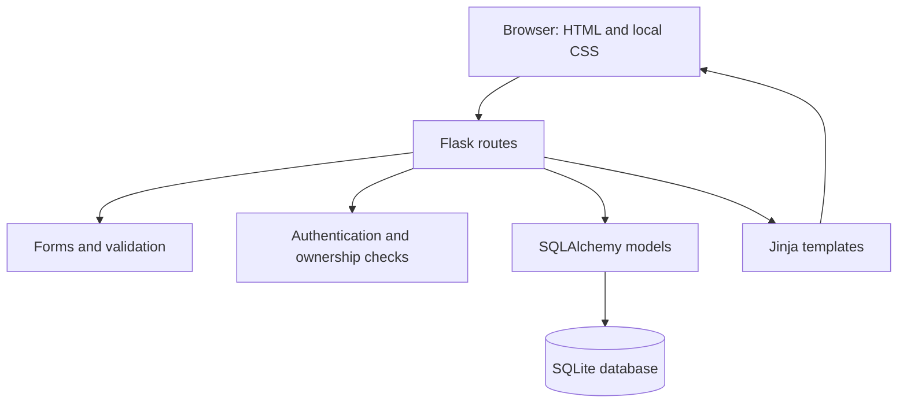

# Implementation baseline and engineering notes

## Context

InternTrack implements the accepted conversation scope in the project proposal: individual project for Abdulrazzaq Shewia, CIS 375, Professor Dr. Raef Aidibi, final deadline November 1, 2026. The proposal is a planning baseline; instructor approval has not been independently verified. This implementation package is not evidence of proposal approval or completed student reviews.

## Architecture

- Factory and shared extensions: `interntrack/__init__.py`.
- Persistent data: `interntrack/models.py`.
- Input rules: `interntrack/forms.py`.
- HTTP workflows and scoped queries: `interntrack/routes.py`.
- Optional seed command: `interntrack/demo.py`.
- Local launcher: `run.py`.
- Presentation: `interntrack/templates/` and `interntrack/static/style.css`.

## Initial data design

One User owns many Applications through the non-null foreign key `application.user_id`. SQLite foreign key enforcement is enabled. Username is normalized to lowercase and constrained to be unique. Status has both form validation and a database check constraint. See `schema.sql` for the generated table definition.

The optional interview timestamp is a naive local date/time, deliberately matching the proposal's single-machine classroom environment. Upcoming interviews are selected where status is Interview and timestamp is at or after the server's current local time. The next five are shown in ascending order. A local classroom launcher keeps browser and server time zones on the same machine.

## Request workflow

1. Login is required for all dashboard and record routes.
2. Flask-WTF checks CSRF for every modifying request, including logout.
3. Each detail, edit, or delete query filters by **both record ID and current user ID**. Missing or foreign records receive 404.
4. Create/edit forms validate all fields before committing. ORM-bound queries avoid string-built SQL.
5. Deletion uses a GET confirmation page and a CSRF-protected POST action.
6. Successful mutations redirect to a GET page, preventing accidental duplicate submissions on refresh.
7. Jinja escapes user text; posting links accept only validated HTTP/HTTPS URLs; external links use noopener/noreferrer.

## Backlog / acceptance mapping

| Story | Priority | Implementation status | Acceptance evidence |
|---|---|---|---|
| As a student, I can register and sign in to a personal workspace. | Must | Implemented | Registration/hash/login/duplicate tests |
| As a student, I can create and revisit an application. | Must | Implemented | CRUD and restart tests |
| As a student, I can update status and notes. | Must | Implemented | Edit workflow tests |
| As a student, I can remove an application after confirmation. | Must | Implemented | GET preserves record; valid POST deletes |
| As a student, I can search and filter my records. | Must | Implemented | Case-insensitive/literal search and filtering tests |
| As a student, I can see status totals and future interviews. | Must | Implemented | Dashboard counts and interview selection checks |
| As a student, I cannot access another user's data. | Must | Implemented | Cross-account list/detail/edit/delete checks |
| As a student, I can export CSV or view a calendar. | Optional | Deferred | Outside delivered scope |

“Implemented” refers to this generated code and recorded automated checks. It does not imply student acceptance or instructor sign-off.

## Proposal changes

| Item | Proposal | Delivered baseline | Reason |
|---|---|---|---|
| Styling | Bootstrap proposed | Custom responsive local CSS | Fewer runtime dependencies; no CDN; consistent interface |
| List size | Not specified | 10 records per page | Keep large lists readable and bounded |
| Schedule | Short planned iterations Oct. 23–Nov. 1 | Initial implementation assembled in this assistance session | Planned iterations are not presented as historical work |
| Public hosting | Optional / outside required scope | Local only | Match the proposed Python/SQLite delivery |
| Optional features | CSV/calendar if time permits | Deferred | Protect required scope and validation time |

## Review observations and resolutions

- Ownership must be enforced in queries, not only by hiding links: applied to all record routes and tested with another account.
- Search wildcards can change user expectations: `%` and `_` are escaped for literal substring matching.
- Repeated demo imports could duplicate or overwrite records: seed command refuses an existing username and creates a dedicated account only.
- Session signing must survive restarts without committing a secret: generated private runtime file, excluded from packaging/Git.
- Empty normalized company/position must not pass validation: nonempty length checks run after trimming whitespace.
- Untrusted job URLs must not execute scripts or embed credentials: HTTP/HTTPS-only validation with hostname, whitespace, port, and credential checks.
- Large lists should stay bounded: pagination with clamped page numbers.

These are implementation review notes from this session, not fabricated peer or instructor reviews.

## Development activities still requiring the student's participation

- Run the application on the actual Windows computer.
- Execute the manual browser and usability checklist; record actual outcomes.
- Review and understand every component, making any needed changes.
- Record real commits, issues, feedback, and retrospectives as subsequent work occurs.
- Prepare the final report, evaluate outcomes, and present the working software.
- Include an accurate description of assistance used according to course instructions.

## References

The user-provided CIS 375 assignment and project proposal establish the requirements. Technical references:

- https://flask.palletsprojects.com/en/stable/patterns/appfactories/
- https://flask.palletsprojects.com/en/stable/testing/
- https://flask-wtf.readthedocs.io/en/latest/csrf/
- https://docs.sqlalchemy.org/en/20/core/constraints.html
